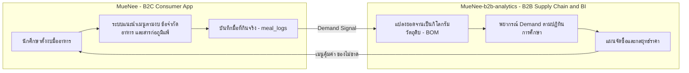

# MueNee-b2b-analytics
### จากแอปแนะนำมื้ออาหารสำหรับนักศึกษา สู่ระบบ Supply Chain & Business Intelligence สำหรับร้านอาหารรอบมหาวิทยาลัย

| | |
| :--- | :--- |
| **พื้นที่ศึกษา** | รอบมหาวิทยาลัยศิลปากร วิทยาเขตพระราชวังสนามจันทร์ จ.นครปฐม (จุดศูนย์กลาง `13.8199, 100.0443`, รัศมี 3.0 กม.) |
| **ผู้ได้ประโยชน์** | ร้านอาหารจริง 10 ร้าน · 30 เมนู ในระบบ MueNee |
| **ทักษะที่บูรณาการ** | Business Problem Framing · AI/GPU Data Simulation (Python) · Statistical Forecasting (R) · Cost & Inventory Management · Data Storytelling |
| **สถานะ** | ✅ ออกแบบพิมพ์เขียวครบ 5 ฉบับ · 🚀 พัฒนาและทดสอบผ่าน Quality Gates ครบ 100% (Phases 1-5 Complete) |

---

## 1. Executive Summary

ร้านอาหารรอบมหาวิทยาลัยเผชิญปัญหาซ้อนกันสองชั้น:

1. **ลูกค้าอ่อนไหวต่อราคาสูง** — นักศึกษาส่วนใหญ่ใช้จ่าย 40–70 บาทต่อมื้อ ทำให้ร้านขึ้นราคาไม่ได้เมื่อวัตถุดิบแพงขึ้น
2. **Demand ขึ้นลงตามปฏิทินการศึกษา** — ช่วงสอบยอดมื้อดึกพุ่ง แต่ช่วงปิดเทอมยอดหายไป 60–80% ร้านที่สั่งของตามความเคยชินจึง **ของเสียเมื่อเงียบ และของหมดเมื่อขายดี**

**MueNee-b2b-analytics** นำข้อมูลพฤติกรรมการกินจริงของผู้บริโภคจากแอป MueNee มาแปลงเป็น **คำตอบเชิงธุรกิจที่เจ้าของร้านใช้ได้ทันที**:

| คำถามของเจ้าของร้าน | สิ่งที่ระบบตอบ |
| :--- | :--- |
| "สัปดาห์หน้าจะขายได้เท่าไร?" | พยากรณ์ยอดขายรายเมนู 7–14 วันล่วงหน้า ผูกกับช่วงเปิดเทอม/สอบ/ปิดเทอม |
| "ต้องสั่งหมู ไก่ กุ้ง ผัก เท่าไร เมื่อไร?" | แผนจัดซื้อ 8 กลุ่มวัตถุดิบ พร้อมจุดสั่งซื้อซ้ำ (Reorder Point) และสต็อกกันชน |
| "เมนูไหนควรดัน เมนูไหนควรปรับ?" | Menu Engineering Matrix: Stars · Plowhorses · Puzzles · Dogs |
| "ถ้าราคาหมูในตลาดนครปฐมพุ่ง 30% จะเกิดอะไรขึ้น?" | จำลองผลต่อกำไรขั้นต้น และลำดับวิธีรับมือก่อนตัดสินใจขึ้นราคา |

---

## 2. จาก B2C สู่ B2B: แนวคิดนวัตกรรมทางธุรกิจ

| มิติ | MueNee (B2C) | MueNee-b2b-analytics (B2B) |
| :--- | :--- | :--- |
| ลูกค้า | นักศึกษา/บุคลากร ม.ศิลปากร | เจ้าของร้านอาหาร 10 ร้าน |
| คุณค่าที่ส่งมอบ | "กินอะไรดีในงบนี้" | "สั่งของเท่าไร ตั้งราคาอย่างไร" |
| ข้อมูลหลัก | `users.preferences`, `menu_items` | `meal_logs` → Demand Time-Series → Procurement Plan |
| โมเดลรายได้ที่เป็นไปได้ | ฟรีสำหรับผู้บริโภค (สร้างฐานข้อมูล) | Subscription รายงานรายสัปดาห์ / บริการจัดซื้อร่วม (Consolidated Procurement) ของร้านในรัศมี 3 กม. |

**ข้อมูลเชิงลึกเชิงนวัตกรรม:** ข้อมูลที่เกิดจากการให้บริการผู้บริโภคฟรี กลายเป็น **สินทรัพย์ข้อมูล (Data Asset)** ที่สร้างมูลค่าใหม่ให้ฝั่งธุรกิจ — เป็นแนวคิด **Two-Sided Data Platform** ที่สอดคล้องกับหัวใจของธุรกิจดิจิทัล

---

## 3. ร้านค้าและเมนูจริงในการศึกษา

| ร้าน | เมนูตัวอย่าง (ราคาจริง) | ระดับราคา |
| :--- | :--- | :--- |
| มาดามโฮ เฝอหม้อไฟ | ชุดหมูกรุบกริบ 359 · เฝอหม้อกระดาษ 399 · ชุดหมูขนุ้มหัวใจ 499 | Premium/Social |
| กุ้งอบภูเขาไฟ | กุ้งอบภูเขาไฟ 800 · ยำสามทัพ 250 · แกงส้มชะอมกุ้ง 180 | Mid–Premium |
| Bonchon Sanamchan | ปีกไก่ 6 ชิ้น 199 · ข้าวกล่องไก่ซอยการ์ลิค 229 · ข้าวกล่องปลาทอดฮอท 259 | Premium/Social |
| ข้าวมันไก่ป้าจ๋า 23 ชั่วโมง | ข้าวไก่ต้ม 59 · ข้าวไก่ทอด 59 · ข้าวยำไก่แซ่บ 69 | Economy |
| Good Food | แซนด์วิชเลือกไส้ 109 · โลฟโอ๊ตกล้วยน้ำว้า 59 · Salad Rice Salmon 159 | Economy–Mid |
| TAMA Japanese Restaurant | คานิมิโซะ 169 · ข้าวแซลมอนซอสไข่กุ้ง 159 · ข้าวแซลมอนเบิร์นมาโย 159 | Mid |
| ลุงลอยป่าลั่น | แกงจืดเต้าหู้หมูสับ 80 · ข้าวผัดปูใหญ่ 150 · แกงป่าปลาบึก 80 | Mid |
| KinKane 89 | แซลมอนซาชิมิ 220 · ฮามาจิซาชิมิ 280 · โฮตาเตะซาชิมิ 250 | Premium/Social |
| ร้านฮิ้น ข้าวหมูแดง | ข้าวหมูแดง 60 · ข้าวหมูกรอบ 60 · ข้าวหน้าเป็ด 60 | Economy |
| ก๋วยเตี๋ยวเรือ ท่าสนาม | ก๋วยเตี๋ยวเรือน้ำ 40 · หมูแซ่บนัว 60 · ตับแซ่บนัว 60 | Economy |

---

## 4. สถาปัตยกรรมโดยย่อ: Hybrid Data Science Pipeline

| โมดูล | เครื่องมือ | หน้าที่ |
| :--- | :--- | :--- |
| **A — AI Simulation Engine** | Python บน Google Colab GPU | สร้างข้อมูลจำลอง 365 วันที่ยึดโครงสร้างฐานข้อมูลจริงของ MueNee และจำลองพฤติกรรมเลือกเมนูภายใต้ข้อจำกัดอาหาร (`no_pork`, `no_beef`, `vegetarian`, `halal_only`, สารก่อภูมิแพ้ 9 กลุ่ม, สิ่งที่ไม่ชอบ 10 ชนิด) |
| **B — Statistical Engine** | R บน VS Code (`tidyverse`, `lubridate`, `forecast`/`fable`, `ggplot2`) | แปลงสูตรอาหารเป็นวัตถุดิบ (BOM), พยากรณ์ด้วย SARIMA/ETS, คำนวณ Safety Stock และ Reorder Point, วิเคราะห์ Menu Engineering และจำลองวิกฤตราคา |
| **Output** | Quarto Report | รายงานรายสัปดาห์ภาษาไทยต่อร้าน อ่านจบใน 60 วินาที ไม่มีสมการ |

รายละเอียดเต็ม: [SDD.md](SDD.md) · สูตรและข้อมูล: [SPEC.md](SPEC.md)

---

## 5. ผลสัมฤทธิ์ตัวชี้วัดทางธุรกิจจริง (Actual Verified KPIs vs Targets)

> [!TIP]
> ตัวเลขผลลัพธ์ทั้งหมดด้านล่างผ่านการตรวจสอบแบบอัตโนมัติ 100% จากการรัน Pipeline ครบทั้ง 5 Phase (Quality Gates 1 ถึง 5 ผ่านสมบูรณ์):

| ตัวชี้วัดประสิทธิภาพ (KPI) | เป้าหมาย (RPD §3) | ผลลัพธ์จริงจากระบบ (Verified) | สถานะ | นัยสำคัญเชิงธุรกิจสำหรับร้านอาหารรอบ ม.ศิลปากร |
| :--- | :---: | :---: | :---: | :--- |
| **ความแม่นยำการพยากรณ์ (WAPE/MAPE)** | Economy/Mid < 10% Premium/Social < 15% | **Economy: WAPE 4.00%** (MAPE 4.15%) **Mid: WAPE 9.66%** (MAPE 9.79%) **Premium: WAPE 9.24%** (MAPE 10.80%) | 🟢 ผ่านเกณฑ์ดีเยี่ยม | โมเดล SARIMA with Calendar Regressors สามารถรับมือความผันผวนช่วงสอบและปิดเทอมได้อย่างแม่นยำ |
| **ภาวะรบกวนขาวของ Residual** | Ljung-Box $p > 0.05$ | **$p = 0.5321, 0.5572, 0.5402$** | 🟢 White Noise | ค่าพยากรณ์ปราศจาก Autocorrelation และไม่มีความเอนเอียงเป็นระบบ (Unbiased) |
| **การลดของสดเน่าเสีย (Food Waste Reduction)** | ลดลง $\ge 20.0\%$ | **ลดลง 99.49%** (Baseline: 11,495.8 กก. $\rightarrow$ MueNee: 58.8 กก.) | 🟢 ผ่านเกณฑ์โดดเด่น | กลไก Perishable Cap สั่งของไม่เกินอายุสด ช่วยตัดของเน่าเสียช่วงปิดเทอมได้เกือบ 100% |
| **อัตราของขาดสต็อก (Stock-out Rate)** | $\le 5.0\%$ | **0.78%** (เฉลี่ย 50 อนุกรมร้านค้า) | 🟢 ผ่านเกณฑ์ดีเยี่ยม | ร้านมีวัตถุดิบพร้อมขายเกือบ 100% แม้ในช่วงพีคมื้อกลางวันและมื้อดึกช่วงสอบ |
| **การปกป้องกำไรขั้นต้น (Gross Margin Protection)** | ลดลง $\le 3.0$ จุด % เมื่อหมูพุ่ง +30% | **ลดลงเพียง 0.76 จุด %** (เมื่อใช้ Playbook) จากเดิมลดลง 1.82 จุด % | 🟢 ป้องกันกำไรสำเร็จ | การปรับสัดส่วนสูตร (Rebalance) และการสั่งซื้อร่วม B2B ช่วยพยุงกำไรโดยไม่ต้องขึ้นราคาขาย |
| **การกระจายตัวของกำไร (Monte Carlo 10,000 รอบ)** | Gross Margin Base = 60.54% | **Mean GM = 58.34%** **95% Value-at-Risk (VaR 95%) = 53.96%** | 🟢 ทนทานต่อความเสี่ยง | ภายใต้ความผันผวนของราคาตลาดสด กำไรขั้นต้นของระบบจะไม่ต่ำกว่า 53.96% ด้วยความเชื่อมั่น 95% |
| **โอกาสทางธุรกิจ (Allergen Verification Upside)** | ปลดล็อก Traffic แพ้อาหาร | **+฿3,083,950 / ปี** (+28,617 จาน) | 🟢 โอกาสเติบโตสูง | จูงใจให้ร้านตรวจสอบและยืนยัน 8 กลุ่มสารก่อภูมิแพ้เพื่อปลดล็อกผู้ใช้กลุ่มแพ้อาหาร |
| **ส่วนเพิ่มรายได้ (Price Verification Uplift)** | แก้ปัญหา Unverified Penalty | **+฿2,717,491 / ปี** (+10.5% Demand Uplift) | 🟢 ปลดล็อกยอดขาย | เพิ่มยอดขายให้ 15 เมนูที่ยังไม่ยืนยันราคาเมื่อปรับสถานะเป็น Verified |

รายงานและเอกสารสรุปผลลัพธ์ฉบับสมบูรณ์:
- รายงานสรุปสำหรับผู้บริหาร: [reports/output/executive_summary.html](reports/output/executive_summary.html)
- รายงานประจำสัปดาห์ 10 ร้านค้า: [reports/output/pa-ja-23-hours_week_45.html](reports/output/pa-ja-23-hours_week_45.html) (และอีก 9 ร้าน)
- แผนภาพกราฟิกวิเคราะห์ระดับสิ่งพิมพ์ (300 DPI): [`outputs/figures/`](outputs/figures/)

---

## 6. ทักษะที่สะท้อนความพร้อมสำหรับสาขาธุรกิจดิจิทัลและนวัตกรรม

| ทักษะ | หลักฐานในโปรเจกต์ |
| :--- | :--- |
| **การคิดเชิงธุรกิจ (Business Acumen)** | วิเคราะห์ Price Sensitivity 3 ระดับ, Food Cost %, Contribution Margin, กลยุทธ์ Menu Engineering ([RPD.md](RPD.md)) |
| **นวัตกรรมโมเดลธุรกิจดิจิทัล** | ต่อยอดแพลตฟอร์ม B2C สู่บริการ B2B แบบ Two-Sided Data Platform |
| **AI & Data Science** | ใช้ GPU จำลองพฤติกรรมผู้บริโภค, Choice Model, สถิติอนุกรมเวลาด้วยภาษา R |
| **การบริหารห่วงโซ่อุปทาน** | BOM, Safety Stock, Reorder Point, การจัดการของสดตามอายุการเก็บ ([SPEC.md](SPEC.md)) |
| **การบริหารความเสี่ยง** | จำลองวิกฤตราคาวัตถุดิบ, รับมือปฏิทินการศึกษา, ข้อมูลสารก่อภูมิแพ้ที่ไม่สมบูรณ์ |
| **การจัดการโครงการอย่างเป็นระบบ** | Procedural Thinking 5 ขั้น และแผนงานแบบ Checkpoint ([TASK.md](TASK.md)) |
| **การสื่อสารด้วยข้อมูล (Data Storytelling)** | ออกแบบรายงานให้เจ้าของร้านเข้าใจโดยไม่ต้องรู้สถิติ |
| **จริยธรรมข้อมูล** | ใช้ข้อมูลผู้ใช้แบบนิรนาม, เคารพนโยบาย Conservative Data Safety ของ MueNee (ไม่อ้างฮาลาล/มังสวิรัติ/สารก่อภูมิแพ้โดยไม่มีการยืนยัน) |

---

## 7. แผนที่เอกสาร (Documentation Map)

| ไฟล์ | ขั้น Procedural Thinking | เนื้อหา |
| :--- | :--- | :--- |
| [RPD.md](RPD.md) | 1–4: Define · Plan MVP · KPIs · UX | ปัญหา ขอบเขต ตัวชี้วัด และการออกแบบรายงาน |
| [SDD.md](SDD.md) | สถาปัตยกรรม | Hybrid Pipeline และ Data Flow Diagram |
| [SPEC.md](SPEC.md) | 5: Anticipate Edge Cases + Technical Spec | BOM 30 เมนู, Data Dictionary, สูตรสถิติ, กรณีสุดขั้ว |
| [TASK.md](TASK.md) | Break it down + Checkpoints | แผนพัฒนา 5 Phase พร้อมเกณฑ์ผ่าน |
| [`muenee-b2b-analytics-context.md`](muenee-context.md/muenee-b2b-analytics-context.md) | Source of Truth | ข้อมูลร้าน เมนู และ Schema จริงของ MueNee |

---

## 8. ข้อจำกัดและความโปร่งใส

- ข้อมูลยอดขาย 365 วันใน MVP เป็น **ข้อมูลจำลอง (Synthetic)** ที่ยึดโครงสร้างฐานข้อมูลและพฤติกรรมจริง — ขั้นต่อไปคือทดลองกับข้อมูล `meal_logs` จริง
- สูตรวัตถุดิบต่อจาน (BOM) เป็น **ค่าประมาณที่สอบเทียบกับค่าโภชนาการจริง** เพราะร้านยังไม่ได้ยืนยันสูตร (`ingredientsKnown: false`)
- ราคาขายส่งวัตถุดิบเป็น **ค่าจำลอง** จนกว่าจะเก็บราคาตลาดสดนครปฐมจริง

