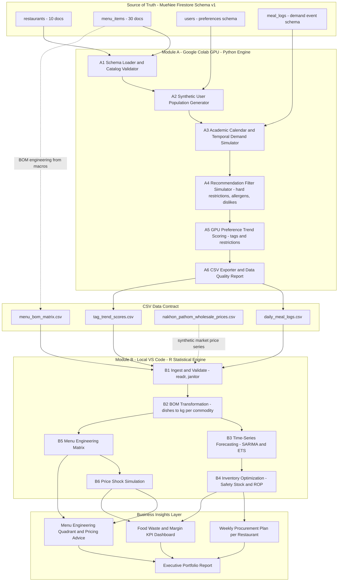
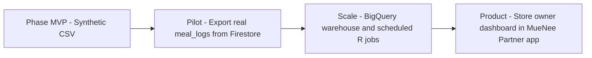

# SDD — System Design Document
## MueNee-b2b-analytics: Hybrid Data Science Pipeline

| รายการ | รายละเอียด |
| :--- | :--- |
| เวอร์ชันเอกสาร | 1.0 (Architecture Blueprint) |
| อ้างอิง | [RPD.md](RPD.md) · [SPEC.md](SPEC.md) · [`muenee-b2b-analytics-context.md`](muenee-context.md/muenee-b2b-analytics-context.md) |
| รูปแบบสถาปัตยกรรม | Hybrid 2-Engine Batch Pipeline (Python on Cloud GPU → R on Local Workstation) |
| สัญญาเชื่อมต่อระหว่างโมดูล | ไฟล์ CSV ตาม Data Dictionary ใน [SPEC.md §2](SPEC.md) |

---

## 1. Architectural Overview

### 1.1 เหตุผลการเลือกสถาปัตยกรรมแบบ Hybrid

| ความต้องการ | เครื่องมือที่เหมาะสม | เหตุผล |
| :--- | :--- | :--- |
| สร้างข้อมูลจำลองหลักแสนแถว + จำลองผู้ใช้ที่มีข้อจำกัดอาหารหลายมิติ + คำนวณคะแนน Preference แบบเวกเตอร์ | **Python บน Google Colab GPU** | ประมวลผลแบบขนาน (Vectorized/GPU) เร็ว, ไม่ต้องลงทุนฮาร์ดแวร์ |
| พยากรณ์อนุกรมเวลา, สถิติสินค้าคงคลัง, กราฟคุณภาพตีพิมพ์ | **R บน VS Code (Local)** | ระบบนิเวศ `forecast`/`fable` เป็นมาตรฐานงานพยากรณ์เชิงสถิติ, `ggplot2` สร้างกราฟระดับรายงานผู้บริหาร |
| ความโปร่งใสและตรวจสอบย้อนกลับได้ | **CSV เป็น Contract** | เปิดดูได้ด้วย Excel, เจ้าของร้าน/กรรมการตรวจสอบได้, แยกความรับผิดชอบสองโมดูลชัดเจน |

### 1.2 หลักการออกแบบ (Design Principles)

1. **Schema Fidelity** — ทุกฟิลด์ที่ Module A สร้างต้องแมปกลับไปยัง Firestore Schema `schemaVersion: 1` ได้ (`meal_logs`, `users`, `menu_items`, `restaurants`)
2. **Closed Catalog** — ใช้ 10 `restaurantId` และ 30 `menuItemId` จริงเท่านั้น ห้ามมีค่านอก Catalog
3. **Reproducibility** — ทุกการสุ่มกำหนด Random Seed คงที่ และบันทึกเวอร์ชันพารามิเตอร์ลงไฟล์ Metadata
4. **Conservative Data Safety** — เคารพแฟล็ก `allergensKnown: false`, `halalConfirmed: false`, `vegetarianConfirmed: false` ตามนโยบายของ MueNee
5. **Business-First Output** — ผลลัพธ์สุดท้ายต้องแปลงเป็นภาษาธุรกิจที่เจ้าของร้านเข้าใจ (ดู [RPD.md §4](RPD.md))

---

## 2. Data Flow Diagram

---

## 3. Module A — Google Colab GPU (Python Engine)

> [!NOTE]
> เอกสารนี้กำหนดเฉพาะ **สถาปัตยกรรมและสัญญาข้อมูล** — ยังไม่มีการเขียนโค้ด Python ในขั้นตอนนี้

### 3.1 สภาพแวดล้อม (Runtime)

| รายการ | ข้อกำหนด |
| :--- | :--- |
| แพลตฟอร์ม | Google Colab (GPU Runtime เช่น T4) |
| ไลบรารีหลัก (แผน) | `pandas` / `numpy` (Baseline CPU), `cudf` / `cupy` (RAPIDS, GPU-accelerated DataFrame), `torch` (Embedding/Scoring บน GPU), `faker` (ไม่ใช้สร้างชื่อร้าน/เมนู — ใช้เฉพาะ `userId` นิรนาม) |
| Random Seed | ค่าเดียวทั้ง Pipeline เช่น `20260101` บันทึกใน `run_metadata.json` |
| ช่วงเวลาข้อมูล | 365 วันต่อเนื่อง (1 ปีการศึกษา ครอบคลุม 2 ภาคปกติ + ภาคฤดูร้อน + ช่วงปิดภาค) |

### 3.2 ส่วนประกอบย่อย (Sub-components)

| ID | ชื่อ | หน้าที่ | อินพุต | เอาต์พุต |
| :-: | :--- | :--- | :--- | :--- |
| A1 | Schema Loader & Catalog Validator | โหลด Seed Catalog 10 ร้าน/30 เมนู, ตรวจ Foreign Key `menu_items.restaurantId → restaurants` | Context Seed Data | ตาราง Catalog ที่ผ่านการตรวจ |
| A2 | Synthetic User Population | สร้างประชากรผู้ใช้ตาม `UserDocument` (นักศึกษา, บุคลากร, ผู้อาศัยหอพัก) กำหนดสัดส่วน `hardRestrictions`, `allergies` 9 กลุ่ม, `dislikes` 10 ชนิด, `hideDisliked` | Schema `users` + พารามิเตอร์สัดส่วน | `synthetic_users` (ภายใน) |
| A3 | Academic Calendar & Temporal Simulator | สร้างจำนวนมื้อต่อวัน/ชั่วโมง ตาม Peak Hours (11:30–13:30, 17:30–20:30), วันในสัปดาห์, ปฏิทินการศึกษา (ดู [SPEC.md §4.1](SPEC.md)) | ปฏิทิน + Multiplier | Demand Intensity ต่อชั่วโมง |
| A4 | Recommendation Filter Simulator | จำลองตรรกะคัดกรองของ MueNee: Hard Exclusions (AND), Allergen + `allergensKnown: false` (คัดทิ้ง), Dislikes (Soft rank / Hide), Price Confidence penalty, งบประมาณ `MealBudget` | ผู้ใช้ × เมนู | ชุดเมนูที่ผู้ใช้แต่ละคนเลือกได้จริง |
| A5 | GPU Preference Trend Scoring | คำนวณ **Tag Demand Score** และ **Restriction Exposure Index** ต่อเมนูต่อวัน ด้วย Matrix ผู้ใช้ × Tag × เมนู บน GPU | ผลจาก A4 | `tag_trend_scores.csv` |
| A6 | CSV Exporter & DQ Report | สุ่มเหตุการณ์ `meal_logs` จาก Demand Intensity × ความน่าจะเป็นการเลือก, Aggregate รายวัน, ตรวจคุณภาพข้อมูล | ผลจาก A3–A5 | `daily_meal_logs.csv`, รายงาน DQ |

### 3.3 Restriction & Preference Feature Space

| มิติ | ค่าที่เป็นไปได้ (Enum จริง) | ตรรกะใน A4/A5 |
| :--- | :--- | :--- |
| Hard Restrictions | `no_pork`, `no_beef`, `vegetarian`, `halal_only` | ตัดเมนูออก (AND); `halal_only` ตัดทั้ง 30 เมนู เพราะ `halalConfirmed: false`; `vegetarian` ตัดทั้ง 30 เมนู เพราะ `vegetarianConfirmed: false` |
| Allergens (9) | `peanut`, `tree_nuts`, `milk`, `egg`, `soy`, `wheat`, `fish`, `shellfish`, `sesame` | ผู้ใช้ที่ระบุ Allergy ≥ 1 รายการ → ทุกเมนูถูกคัดทิ้ง เพราะ `allergensKnown: false` ทั้งหมด (ดู Edge Case ใน SPEC.md §4.2) |
| Dislikes (10) | `pork`, `beef`, `chicken`, `fish`, `shellfish`, `egg`, `milk`, `mushroom`, `coriander`, `offal` | Soft: ลดอันดับ; `hideDisliked: true` → ตัดทิ้ง |
| Tags | เช่น `thai`, `rice`, `spicy`, `japanese`, `salmon`, `sashimi`, `hot-pot`, `shared`, `healthy`, `korean`, `fried`, `chicken`, `seafood`, `noodles`, `soup`, `curry`, `pork`, `offal`, `duck` ฯลฯ | ใช้เป็นแกนคะแนนเทรนด์ |
| Price Confidence | `verified`, `estimated`, `unverified` | ค่าปรับลดความน่าจะเป็นการเลือกสำหรับ `unverified` |

### 3.4 Output Quality Gates (ก่อนส่งต่อ Module B)

- [ ] `menuItemId` ทุกแถวอยู่ใน 30 รหัสจริง และ `restaurantId` ตรงกับเจ้าของเมนู
- [ ] ครบ 365 วัน × 30 เมนู (วันที่ยอดเป็นศูนย์ต้องบันทึกเป็น `0` ไม่ใช่ค่าว่าง)
- [ ] ยอดช่วงปิดภาคลดลง 60–80% เทียบค่าเฉลี่ยช่วงเปิดเทอม
- [ ] สัดส่วนยอดขาย Economy > Mid > Premium/Social (ตาม High Volume ของ Economy)
- [ ] ไม่มี `meal_logs` ใดที่ละเมิด Hard Restriction ของผู้ใช้

---

## 4. Module B — Local VS Code (R Statistical Engine)

> [!NOTE]
> กำหนดเฉพาะโครงสร้างสคริปต์และหน้าที่ — ยังไม่มีการเขียนโค้ด R ในขั้นตอนนี้

### 4.1 สภาพแวดล้อม

| รายการ | ข้อกำหนด |
| :--- | :--- |
| IDE | VS Code + R Extension (`languageserver`, `httpgd` สำหรับแสดงกราฟ) |
| เวอร์ชัน | R ≥ 4.3 |
| การจัดการแพ็กเกจ | `renv` (ล็อกเวอร์ชันใน `renv.lock`) |
| แพ็กเกจหลัก | `tidyverse` (`readr`, `dplyr`, `tidyr`, `purrr`), `lubridate`, `forecast` และ/หรือ `fable` + `tsibble` + `feasts`, `ggplot2`, `janitor`, `scales`, `patchwork` |
| แพ็กเกจเสริม | `yardstick` (MAPE), `rmarkdown`/`quarto` (รายงาน), `here` (จัดการ Path) |

### 4.2 โครงสร้างสคริปต์ (Pipeline Stages)

| ID | สคริปต์ (แผน) | หน้าที่ | อินพุต | เอาต์พุต |
| :-: | :--- | :--- | :--- | :--- |
| B1 | `r/01_ingest_validate.R` | อ่าน CSV, ตรวจ Schema/ชนิดข้อมูล/ค่าซ้ำ/ค่าหาย, ตรวจ Closed Catalog | CSV 4 ไฟล์ | Tibble ที่สะอาด (`data/processed/*.rds`) |
| B2 | `r/02_bom_transform.R` | Join ยอดขายรายวัน × BOM → กรัม → กก. ต่อกลุ่มวัตถุดิบ 8 กลุ่ม ต่อร้าน ต่อวัน | `daily_meal_logs`, `menu_bom_matrix` | `commodity_daily_demand` |
| B3 | `r/03_forecast.R` | สร้าง `tsibble` รายวัน (m = 7), เทียบ SARIMA vs ETS ด้วย Time-Series Cross-Validation, เลือกโมเดลตาม MAPE | `commodity_daily_demand`, ยอดรายเมนู | `forecast_results.csv` (Point + PI 80/95%) |
| B4 | `r/04_inventory_optimization.R` | คำนวณ Safety Stock, ROP, ปริมาณสั่งแนะนำ ตาม Lead Time ของแต่ละกลุ่มวัตถุดิบ | Forecast + Residual σ | `procurement_plan.csv` |
| B5 | `r/05_menu_engineering.R` | คำนวณ Food Cost จาก BOM × ราคาขายส่ง, Contribution Margin, Popularity Index → 4 Quadrant | ยอดขาย + BOM + ราคา | `menu_engineering.csv` + Quadrant Chart |
| B6 | `r/06_price_shock.R` | จำลองราคาวัตถุดิบพุ่ง (Scenario & Monte Carlo), วัดผลต่อ Gross Margin และการย้าย Quadrant | ผลจาก B5 + ราคา | `price_shock_scenarios.csv` |
| B7 | `reports/weekly_store_report.qmd` | ประกอบรายงานต่อร้าน (ภาษาไทย ไม่มีสมการ) | ผล B4–B6 | HTML/PDF รายร้าน |

---

## 5. Repository Layout (แผนโครงสร้างโฟลเดอร์)

| Path | เนื้อหา |
| :--- | :--- |
| `muenee-context.md/` | เอกสาร Domain Context ต้นฉบับ (Source of Truth) |
| `RPD.md`, `SDD.md`, `SPEC.md`, `TASK.md`, `README.md` | เอกสารพิมพ์เขียว 5 ฉบับ |
| `colab/` | Notebook ของ Module A |
| `config/` | พารามิเตอร์ปฏิทินการศึกษา, Multiplier, Lead Time, Z-score (YAML) |
| `data/raw/` | CSV ที่ส่งออกจาก Module A (ไม่แก้ไขด้วยมือ) |
| `data/reference/` | `menu_bom_matrix.csv`, `nakhon_pathom_wholesale_prices.csv` |
| `data/processed/` | ผลลัพธ์ระหว่างทางของ R |
| `r/` | สคริปต์ Module B (B1–B6) |
| `outputs/` | ตาราง/กราฟผลลัพธ์ |
| `reports/` | รายงาน Quarto ต่อร้านและรายงานผู้บริหาร |

---

## 6. Non-Functional Requirements

| หมวด | ข้อกำหนด |
| :--- | :--- |
| Reproducibility | รันซ้ำด้วย Seed เดิมต้องได้ CSV ที่ Hash ตรงกัน; R ล็อกแพ็กเกจด้วย `renv` |
| Performance | Module A สร้างข้อมูล 365 วันเสร็จภายใน 10 นาทีบน Colab GPU; Module B รันครบ B1–B6 ภายใน 15 นาทีบนเครื่อง Local |
| Data Privacy | `userId` เป็นรหัสสุ่มนิรนาม ไม่มีข้อมูลส่วนบุคคลจริง; ไม่ส่งออก `profile` (อายุ/น้ำหนัก) ลง CSV ที่แชร์ |
| Traceability | ทุกไฟล์ผลลัพธ์มีคอลัมน์หรือ Metadata `run_id` และ `generated_at` |
| Explainability | ทุกคำแนะนำในรายงานต้องอ้างอิงได้ว่ามาจากตัวเลขใด (เช่น Forecast, SS, Food Cost %) |

---

## 7. Integration Roadmap (หลัง MVP)

| ระยะ | การเปลี่ยนแปลงหลัก |
| :--- | :--- |
| Pilot | แทน Synthetic ด้วย Export จริงจาก `meal_logs` (`menuId`, `restaurantId`, `createdAt`) โดยไม่ต้องแก้ Module B เพราะยึด CSV Contract เดิม |
| Scale | ย้ายคลังข้อมูลไป Data Warehouse, ตั้งเวลารัน R รายสัปดาห์ |
| Product | ส่งรายงานผ่านแอปฝั่งร้านค้า และเก็บราคาตลาดจริงต่อเนื่อง |

