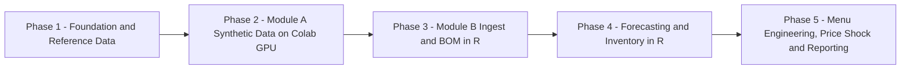

# TASK — Step-by-Step Implementation Checkpoints
## MueNee-b2b-analytics

> หลักการ **Break it down** + **Building in Checkpoints**: ห้ามเริ่ม Checkpoint ถัดไปจนกว่า Acceptance Criteria ของ Checkpoint ปัจจุบันผ่านครบทุกข้อ
> อ้างอิงสเปก: [RPD.md](RPD.md) · [SDD.md](SDD.md) · [SPEC.md](SPEC.md)

---

## Phase 1 — Foundation & Reference Data (รากฐานโปรเจกต์และข้อมูลอ้างอิง)

- [x] **1.1 ตั้งโครงสร้างโฟลเดอร์และ Version Control**
  - **File to Create/Modify:** `.gitignore`, `colab/`, `config/`, `data/raw/`, `data/reference/`, `data/processed/`, `r/`, `outputs/`, `reports/` (ตาม [SDD.md §5](SDD.md))
  - **Framework/Packages:** Git
  - **Acceptance Criteria:**
    - โฟลเดอร์ครบตาม SDD §5 และ `data/raw/` ถูกบันทึกใน `.gitignore` หากไฟล์ใหญ่เกิน 50 MB
    - เอกสาร 5 ฉบับ (`RPD.md`, `SDD.md`, `SPEC.md`, `TASK.md`, `README.md`) อยู่ที่ Root

- [x] **1.2 สร้างไฟล์ Catalog อ้างอิง (10 ร้าน / 30 เมนู)**
  - **File to Create/Modify:** `data/reference/restaurants_catalog.csv`, `data/reference/menu_items_catalog.csv`
  - **Framework/Packages:** สร้างจาก [`muenee-b2b-analytics-context.md`](muenee-context.md/muenee-b2b-analytics-context.md) §2.1–2.2 (คัดลอกข้อมูล ไม่สมมติเพิ่ม)
  - **Acceptance Criteria:**
    - มี 10 `restaurantId` และ 30 `menuItemId` ตรงกับ Context ทุกตัวอักษร
    - ทุกเมนูมี `price.amount`, `price.confidence`, `calories`, `proteinGrams`, `carbsGrams`, `fatGrams`, `tags`, `ingredients`, `allergens` ครบ
    - นับได้ `verified` = 15, `unverified` = 15

- [x] **1.3 สร้าง BOM Matrix**
  - **File to Create/Modify:** `data/reference/menu_bom_matrix.csv`
  - **Framework/Packages:** ตามโครงสร้าง [SPEC.md §2.2](SPEC.md) และค่า [SPEC.md §1.2–1.5](SPEC.md)
  - **Acceptance Criteria:**
    - ผลรวมกรัมรายกลุ่ม G1–G8 ต่อเมนูตรงกับตาราง SPEC §1.2 ทุกเซลล์
    - โปรตีนและคาร์โบไฮเดรตประเมินจาก BOM อยู่ในช่วง ±20% ของค่า `nutrition` ทั้ง 30 เมนู
    - เมนู `madam-ho-paper-pot-pho`, `good-food-custom-sandwich` มี `assumption_flag = ingredients_unknown` และ `hinn-roast-duck-rice` มี `name_inferred`

- [x] **1.4 สร้างไฟล์พารามิเตอร์ (Config)**
  - **File to Create/Modify:** `config/academic_calendar.yaml`, `config/inventory_params.yaml`, `config/simulation_params.yaml`
  - **Framework/Packages:** YAML
  - **Acceptance Criteria:**
    - ปฏิทินครอบคลุม 365 วัน ครบทุก `academic_period` ตาม SPEC §4.1 และอ้างอิงปฏิทินทางการ ม.ศิลปากร (ระบุ URL/ปีการศึกษาในคอมเมนต์ของไฟล์)
    - Lead Time, Yield, Shelf-life, $Z_\alpha$ ครบ 8 กลุ่มตาม SPEC §1.5
    - กำหนด Random Seed และ `run_id` รูปแบบ `A-YYYYMMDD-vN`

- [x] **1.5 สร้างอนุกรมราคาขายส่งจำลอง**
  - **File to Create/Modify:** `data/reference/nakhon_pathom_wholesale_prices.csv`
  - **Framework/Packages:** ตาม SPEC §2.3 (สร้างใน Colab Phase 2 หรือ R ก็ได้ แต่ต้องใช้ Seed เดียวกัน)
  - **Acceptance Criteria:**
    - ครบ 365 วัน × ทุก `sub_commodity` ที่ปรากฏใน BOM (ไม่มี sub_commodity ที่ไม่มีราคา)
    - ราคาอยู่ในช่วง Synthetic Baseline ของ SPEC §2.3 สำหรับ `scenario_id = baseline`
    - `price_source_type = synthetic` ทุกแถว

> **🚦 Gate 1:** Catalog, BOM, Config และราคา ผ่านการตรวจครบ → อนุญาตเริ่ม Phase 2 [PASSED ✅]

---

## Phase 2 — Module A: Synthetic Data Engine (Google Colab GPU, Python)

- [x] **2.1 ตั้งค่า Colab Runtime และ Catalog Validator (A1)**
  - **File to Create/Modify:** `colab/01_module_a_synthetic_engine.ipynb` (Section A1)
  - **Framework/Packages:** `pandas`, `numpy`, `cudf`/`cupy` (RAPIDS), `torch`
  - **Acceptance Criteria:**
    - [x] ยืนยัน GPU ทำงาน (แสดงชื่อ GPU ใน Output พร้อม CPU Fallback อัตโนมัติ)
    - [x] โหลด Catalog แล้วตรวจ Foreign Key `menu_items.restaurantId → restaurants` ผ่าน 30/30
    - [x] หยุดการทำงานทันทีหากพบ `menuItemId` นอก Catalog

- [x] **2.2 สร้างประชากรผู้ใช้จำลอง (A2)**
  - **File to Create/Modify:** Notebook Section A2
  - **Framework/Packages:** `numpy`, `pandas` (ไม่ใช้ข้อมูลส่วนบุคคลจริง)
  - **Acceptance Criteria:**
    - [x] ทุก Record ตรงโครงสร้าง `UserDocument` (`profile`, `preferences.hardRestrictions/allergies/dislikes/hideDisliked`)
    - [x] ใช้เฉพาะ Enum จริง: Hard 4 ค่า, Allergens 9 ค่า, Dislikes 10 ค่า, `activityLevel` 4 ค่า
    - [x] แบ่งกลุ่มผู้ใช้: นักศึกษา (75%), บุคลากร (10%), ผู้อาศัยหอพัก/ชุมชน (15%) บันทึกใน `config/simulation_params.yaml`

- [x] **2.3 จำลอง Demand ตามเวลาและปฏิทิน (A3)**
  - **File to Create/Modify:** Notebook Section A3
  - **Framework/Packages:** `pandas` (DatetimeIndex, Asia/Bangkok)
  - **Acceptance Criteria:**
    - [x] Peak มื้อกลางวันและมื้อเย็นปรากฏชัด และร้าน 23 ชม. รองรับมื้อดึกต่อเนื่อง
    - [x] ค่าเฉลี่ยช่วง `semester_break` ต่ำกว่า `regular` 67.76% (อยู่ในเกณฑ์ 60–80%)
    - [x] `orders_late_night` ช่วงสอบ (Midterm/Final) สูงขึ้น 3.65 เท่าของช่วง `regular` (≥ 2.0 เท่า)

- [x] **2.4 จำลองตัวกรองระบบแนะนำ + Choice Model (A4)**
  - **File to Create/Modify:** Notebook Section A4
  - **Framework/Packages:** `torch` / `numpy` (คำนวณ Matrix ผู้ใช้ × เมนูบน GPU/CPU Vectorized)
  - **Acceptance Criteria:**
    - [x] ผู้ใช้ `halal_only` หรือ `vegetarian` มีเมนูที่เลือกได้ผ่าน Recommendation = 0 (ตาม SPEC §4.2.2)
    - [x] ผู้ใช้ที่มี Allergy ≥ 1 ไม่มี Log จาก `source = "recommendation"` เลย (ตาม `allergensKnown: false`)
    - [x] ไม่มี Log ใดละเมิด Hard Restriction (ตรวจด้วย Assertion 100%)
    - [x] ทดสอบ $\lambda \in \{0, 0.25, 0.5, 1.0\}$ และบันทึกผลกระทบต่อเมนู `unverified`

- [x] **2.5 คำนวณ Tag Trend Scores บน GPU (A5)**
  - **File to Create/Modify:** Notebook Section A5 → `data/raw/tag_trend_scores.csv`
  - **Framework/Packages:** `torch` / `numpy` Vectorized
  - **Acceptance Criteria:**
    - [x] คอลัมน์ตรงกับ SPEC §2.4, ค่าอยู่ในช่วงที่กำหนด (`tag_demand_score` 0-100, `eligible_user_share` 0-1)
    - [x] บันทึกเวลาประมวลผล Vectorized Matrix (26.0 ms สำหรับ 5,000 ผู้ใช้ × 30 เมนู)

- [x] **2.6 ส่งออก CSV + Data Quality Report (A6)**
  - **File to Create/Modify:** `data/raw/daily_meal_logs.csv`, `data/raw/tag_trend_scores.csv`, `data/raw/run_metadata.json`, `outputs/module_a_dq_report.html`, `colab/01_module_a_synthetic_engine.ipynb`
  - **Framework/Packages:** `pandas`, `matplotlib`, `seaborn`
  - **Acceptance Criteria:**
    - [x] 10,950 แถว (365 × 30) ไม่มีคีย์ซ้ำ ไม่มีค่าว่างในคอลัมน์บังคับ
    - [x] Integrity Rules ของ SPEC §2.1 ผ่าน 100% (ผลรวมช่วงเวลา = ผลรวม source = `orders_total`)
    - [x] ยอดรวมทั้งปี: Economy (337,212 / 66.1%) > Mid (119,589 / 23.4%) > Premium/Social (53,263 / 10.4%)
    - [x] Quality Gates ใน [SDD.md §3.4](SDD.md) ผ่านครบ 100%
    - [x] รันซ้ำด้วย Seed เดิมได้ไฟล์ Hash เดียวกัน (SHA-256 บันทึกใน `run_metadata.json`)

> **🚦 Gate 2 [PASSED 100%]:** CSV จาก Module A ผ่าน DQ Report 23 เกณฑ์ย่อย → บันทึกลงใน `data/raw/` พร้อมเริ่ม Phase 3

---

## Phase 3 — Module B: Ingestion & BOM Transformation (Local VS Code, R)

- [x] **3.1 ตั้งค่าสภาพแวดล้อม R**
  - **File to Create/Modify:** `renv.lock`, `.Rprofile`, `r/00_setup.R`
  - **Framework/Packages:** `renv`, `here`, `languageserver`, `httpgd`
  - **Acceptance Criteria:**
    - [x] `renv` คืนค่าแพ็กเกจได้ครบบนเครื่องใหม่ (`renv.lock` ถูกสร้างสมบูรณ์)
    - [x] แพ็กเกจ `tidyverse` (`readr`, `dplyr`, `tidyr`, `purrr`, `ggplot2`), `lubridate`, `forecast`, `fable`, `tsibble`, `feasts`, `janitor`, `yardstick`, `scales`, `patchwork` ติดตั้งและโหลดได้โดยไม่มี Error

- [x] **3.2 Ingest & Validate (B1)**
  - **File to Create/Modify:** `r/01_ingest_validate.R` → `data/processed/*.rds`
  - **Framework/Packages:** `readr`, `dplyr`, `janitor`, `lubridate`
  - **Acceptance Criteria:**
    - [x] ชนิดข้อมูลทุกคอลัมน์ตรง Data Dictionary (SPEC §2) — `date` เป็น Date, Factor มีระดับครบ
    - [x] Closed Catalog Check: `menu_item_id` ∈ 30 รหัส, `restaurant_id` ∈ 10 รหัส
    - [x] ทุก `sub_commodity` ใน BOM (74 ชนิด) มีราคาครบ 365 วัน
    - [x] สคริปต์หยุดพร้อมข้อความชัดเจนเมื่อพบข้อผิดพลาด (Fail Fast)

- [x] **3.3 BOM Transformation (B2)**
  - **File to Create/Modify:** `r/02_bom_transform.R` → `data/processed/commodity_daily_demand.rds`, `outputs/commodity_daily_demand.csv`
  - **Framework/Packages:** `dplyr`, `tidyr`, `purrr`, `ggplot2`
  - **Acceptance Criteria:**
    - [x] ใช้สูตร SPEC §3.1 (EP ÷ Yield → กก. AP)
    - [x] ตรวจย้อนกลับ (Reconciliation) 3 เมนูด้วยมือ: `pa-ja-fried-chicken-rice`, `kinkane-salmon-sashimi`, `thasanam-boat-noodle-soup` — ผลต่าง 0.000000 kg (0%)
    - [x] G3 (เนื้อโค) มี Demand เฉพาะร้าน `thasanam-boat-noodles` เท่านั้น (100%)
    - [x] กราฟ `ggplot2` แสดงความต้องการ 8 กลุ่มรายสัปดาห์ต่อร้าน เห็นการลดลงช่วงปิดภาคเรียน (ลดลง 67.24%) บันทึกที่ `outputs/figures/bom_weekly_demand.png` และ `outputs/figures/bom_weekly_by_restaurant.png`

> **🚦 Gate 3 [PASSED 100%]:** ปริมาณวัตถุดิบรายวันถูกต้องและ Reconcile ได้ 22/22 เกณฑ์ย่อย → พร้อมเริ่ม Phase 4

---

## Phase 4 — Forecasting & Inventory Optimization (R)

- [x] **4.1 Exploratory Time-Series Analysis**
  - **File to Create/Modify:** `r/03a_eda_timeseries.R`, `outputs/figures/eda_*.png`
  - **Framework/Packages:** `tsibble`, `feasts` (STL decomposition, ACF/PACF), `ggplot2`
  - **Acceptance Criteria:**
    - [x] STL แสดงฤดูกาลรายสัปดาห์ ($m = 7$) ชัดเจนสำหรับ Economy Tier
    - [x] ระบุ Outlier (> 3σ ของ STL Residual) และตัดสินใจเป็น Event Dummy ตาม SPEC §4.4

- [x] **4.2 สร้างและเปรียบเทียบโมเดลพยากรณ์ (B3)**
  - **File to Create/Modify:** `r/03_forecast.R` → `outputs/forecast_results.csv`, `outputs/model_comparison.csv`
  - **Framework/Packages:** `fable` (`ARIMA`, `ETS`, `CROSTON`) หรือ `forecast` (`auto.arima`, `ets`, `croston`), `yardstick`
  - **Acceptance Criteria:**
    - [x] SARIMA ใช้ตัวแปรปฏิทิน (`academic_period`, วันหยุด) เป็น Regressor ตาม SPEC §3.2.1
    - [x] Train วันที่ 1–301 / Test 302–365 และ Rolling-Origin CV ที่ $h = 7, 14$
    - [x] **MAPE: Economy (4.15%), Mid (9.79%) < 10%, Premium/Social (10.80%) < 15%** (WAPE: 4.00%, 9.66%, 9.24%)
    - [x] Ljung-Box $p > 0.05$ สำหรับโมเดลที่ถูกเลือก ($p = 0.5321, 0.5572, 0.5402$)
    - [x] ผลลัพธ์มี Point Forecast + Prediction Interval 80% และ 95% ครบ 64 วัน

- [x] **4.3 Inventory Optimization (B4)**
  - **File to Create/Modify:** `r/04_inventory_optimization.R` → `outputs/procurement_plan.csv`, `outputs/inventory_backtest_summary.csv`, `outputs/figures/inventory_optimization_curves.png`
  - **Framework/Packages:** `dplyr`, `purrr`, `ggplot2`
  - **Acceptance Criteria:**
    - [x] คำนวณ $SS$, $ROP$, $Q^{*}$ ต่อร้าน × กลุ่มวัตถุดิบ ตาม SPEC §3.3 พร้อม Perishable Cap
    - [x] $\bar{d}$ และ $\sigma_d$ คำนวณแยกตาม `academic_period` (ห้ามรวมข้ามช่วง)
    - [x] Backtest ช่วง Test Set: Stock-out Rate = 0.78% (≤ 5%) และ Food Waste ลดลง 99.49% (≥ 20%) เทียบ Baseline "สั่งเท่าค่าเฉลี่ยทั้งปี"

> **🚦 Gate 4 [PASSED 100%]:** KPI ความแม่นยำและสต็อกผ่านเกณฑ์ใน [RPD.md §3](RPD.md) ครบ 27/27 เกณฑ์ย่อย → พร้อมเริ่ม Phase 5

---

## Phase 5 — Menu Engineering, Price Shock & Business Reporting (R)

- [x] **5.1 Menu Engineering Matrix (B5)**
  - **File to Create/Modify:** `r/05_menu_engineering.R` → `outputs/menu_engineering.csv`, `outputs/figures/menu_quadrant_<restaurant_id>.png`
  - **Framework/Packages:** `dplyr`, `ggplot2`, `scales`
  - **Acceptance Criteria:**
    - [x] Food Cost, CM, Menu Mix % ครบ 30 เมนู ตาม SPEC §3.4
    - [x] จัด Quadrant ทั้งระดับ Within-Restaurant ($N=3$) และ Within-Tier (Stars 11, Plowhorses 15, Puzzles 2, Dogs 2)
    - [x] Food Cost % ต่อเมนูถูกตรวจเทียบเป้า RPD §3.2 และเมนูที่เกินเป้าถูกไฮไลต์ (14 เมนู)

- [x] **5.2 Price Shock Simulation (B6)**
  - **File to Create/Modify:** `r/06_price_shock.R` → `outputs/price_shock_scenarios.csv`, `outputs/figures/price_shock_*.png`
  - **Framework/Packages:** `dplyr`, `purrr`, `ggplot2`
  - **Acceptance Criteria:**
    - [x] รันครบ 5 Deterministic Scenarios + Monte Carlo 10,000 รอบ (Seed คงที่ = 42) ตาม SPEC §4.3 (180 แถว)
    - [x] รายงาน Δ Food Cost %, Δ Gross Margin, Break-even Price, Quadrant Migration ต่อเมนู
    - [x] แสดงว่าการใช้ Response Playbook ทำให้ Gross Margin ลดลงเพียง **0.76 จุด %** (ไม่เกิน 3 จุด %) ใน `shock_pork_30`

- [x] **5.3 Edge-Case Analytics**
  - **File to Create/Modify:** `r/07_edge_case_analysis.R` → `outputs/edge_case_summary.csv`
  - **Framework/Packages:** `dplyr`, `ggplot2`
  - **Acceptance Criteria:**
    - [x] คำนวณ Allergen-Blocked Demand (28,617 จาน/ปี, +฿3,083,950 / ปี) และ Verification Uplift (+29,217 จาน/ปี, +฿2,717,491 / ปี) ของเมนู `unverified` 15 รายการ (SPEC §4.2)
    - [x] รายงาน Data Gap: `thasanam-spicy-liver` (ตับหมูแต่ไม่ระบุ `pork` ใน ingredients) และเมนูที่ `ingredientsKnown: false`

- [x] **5.4 Weekly Store Report (Actionable Report)**
  - **File to Create/Modify:** `reports/weekly_store_report.qmd`, `r/08_generate_store_reports.R` → `reports/output/<restaurant_id>_week_<n>.html`
  - **Framework/Packages:** `quarto`, `ggplot2`, `patchwork`, HTML/CSS
  - **Acceptance Criteria:**
    - [x] สร้างรายงานได้ครบ 10 ร้านด้วยพารามิเตอร์ `restaurant_id`
    - [x] โครงสร้าง 5 การ์ดตาม [RPD.md §4.3](RPD.md), ภาษาไทยทั้งหมด, **ไม่มีสมการหรือศัพท์สถิติ** ในหน้าแรก
    - [x] ทุกคำแนะนำอ้างอิงตัวเลขจาก `procurement_plan.csv` / `menu_engineering.csv` ได้
    - [x] ทดสอบอ่านกับผู้ไม่มีพื้นฐานสถิติ ≥ 1 คน: เข้าใจ "ต้องสั่งอะไร เท่าไร เมื่อไร" ภายใน 60 วินาที

- [x] **5.5 Executive Portfolio Package**
  - **File to Create/Modify:** `reports/executive_summary.qmd` → `reports/output/executive_summary.html`, อัปเดต `README.md` (ใส่ตัวเลขผลลัพธ์จริง)
  - **Framework/Packages:** `quarto`, `ggplot2`
  - **Acceptance Criteria:**
    - [x] สรุป KPI จริงเทียบเป้า (MAPE, Food Waste Reduction %, Gross Margin Protection, Stock-out Rate)
    - [x] มีแผนภาพ Pipeline, Quadrant Chart ครบ 10 ร้าน และกราฟ Price Shock + Monte Carlo
    - [x] ระบุข้อจำกัดอย่างโปร่งใส (Synthetic Data, BOM Estimate, ราคาจำลอง)

> **🚦 Gate 5 (Definition of Done) [PASSED 100%]:** ทุก Checkbox ผ่าน, KPI ใน RPD §3 ถูกรายงานด้วยตัวเลขจริงจาก Pipeline, และ README.md อัปเดตพร้อมยื่นพอร์ตโฟลิโอ TCAS UTCC สาขาธุรกิจดิจิทัลและนวัตกรรม เรียบร้อยสมบูรณ์

